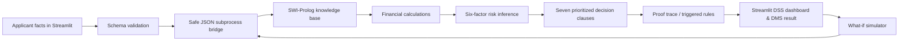

# ✦ LoanWise — Bank Loan Eligibility & Risk Assessment Expert System

**A visually polished, fully explainable academic expert system built with Python Streamlit and real SWI-Prolog rule inference.**

> **Important:** This is fictional, educational software. The loan offers, financial thresholds, interest rates, credit-score ranges, applicant details and decisions are **synthetic model assumptions**, not real Pakistani banking regulations, financial advice, credit underwriting or authorization to lend. Do not input real applicants' personal information or deploy this as a real lending decision-maker.

## Project at a glance

| Requirement | Implementation |
| --- | --- |
| Knowledge-based **expert system** | SWI-Prolog knowledge base (`prolog/loanwise.pl`) |
| At least 50 meaningful Prolog rules | **68 distinct rules**; 61 diagnostic/recommendation rules + 7 priority decisions |
| Decision Support System (DSS) | Affordability, six-factor risk, explanations, recommendations, cross-product comparison, what-if scenario engine |
| Decision Making System (DMS) | Seven mutually exclusive, prioritized Prolog decision gates → `approved`, `manual_review`, `rejected` |
| Frontend | Responsive, styled Python Streamlit dashboard with Plotly analytics |
| Loan products | Personal, Car, Home (different limits, minimum income, collateral and terms) |
| Transparency | Triggered rule IDs, decision reason, categories, severity and downloadable JSON evidence |
| Privacy and safety | Synthetic-only data, schema validation, no database, no real credit bureau/bank connection |
| Quality checks | Automated unit and optional actual-Prolog end-to-end tests |

## Quick start — Windows

1. Install **Python 3.11–3.13** and [SWI-Prolog](https://www.swi-prolog.org/download/stable). During installation, make `swipl.exe` accessible on `PATH`.
2. Open PowerShell in the `LoanWise` directory.
3. Run:

```powershell
python -m venv .venv
.\.venv\Scripts\Activate.ps1
python -m pip install -r requirements.txt
swipl --version
streamlit run app.py
```

Visit **http://localhost:8501**.

If `swipl --version` fails, restart the terminal after installing SWI-Prolog or set its binary path using `SWIPL_BIN`:

```powershell
$env:SWIPL_BIN = "C:\Program Files\swipl\bin\swipl.exe"
streamlit run app.py
```

### macOS / Linux

```bash
# Install SWI-Prolog using your operating system package manager first.
python3 -m venv .venv
source .venv/bin/activate
python -m pip install -r requirements.txt
swipl --version
streamlit run app.py
```

### Deploy to Streamlit Community Cloud

1. Push this folder to a GitHub repository.
2. At [share.streamlit.io](https://share.streamlit.io), choose **Create app**, select the repository, branch `main` and main file `app.py`.
3. Under **Advanced settings**, select Python 3.12, then **Deploy**.

`requirements.txt` installs the Python packages and `packages.txt` installs SWI-Prolog (`swi-prolog-nox`) on the cloud host. The sidebar shows **SWI-Prolog connected** once the deployment is healthy.

## Demo flow for your university presentation

1. Open the **Applicant studio** and click **Strong profile** in the sidebar. Run expert assessment.
2. Go to **Decision intelligence** and show the simulated final decision, modelled EMI, DTI, risk factors, evidence trace and activated rule **D07**.
3. Click **Borderline profile**, assess, and explain why **D05** forces a manual review.
4. Click **High-risk profile**, assess, and demonstrate priority rule **D02** preventing approval due to a recent default.
5. Open **What-if lab**, change income, debt, amount, or term and run a second **real Prolog** evaluation to compare outcomes.
6. Open **Rule explorer** to show the **68 actual Prolog inference rules**, grouped by modules, with triggered-rule filtering.
7. Explain that **DSS gives evidence and alternatives**; **DMS makes the deterministic decision**; every conclusion is rule-based, not ML-generated.

## Architecture



The Python bridge uses `subprocess.run` and passes applicant facts via JSON on `stdin`. There is **no** interpolated Prolog query, command shell, imported loan decision table or Python underwriting fallback. The engine fails closed if SWI-Prolog is absent. JSON transport is used in place of PySwip because it avoids operating-system-specific SWI-Prolog shared-library configuration; the real inference engine remains SWI-Prolog.

## Project files

```text
LoanWise/
├── app.py                      # Streamlit user experience and visual analytics
├── assets/
│   └── style.css                # Custom responsive design system
├── loanwise/
│   ├── __init__.py
│   └── engine.py               # Validated, isolated SWI-Prolog JSON bridge
├── prolog/
│   └── loanwise.pl             # Authoritative expert knowledge base (68 rules)
├── tests/
│   └── test_engine.py          # Validation, bridge and real-inference acceptance tests
├── .streamlit/config.toml
├── requirements.txt            # Python packages (Streamlit Cloud installs these)
├── packages.txt                # System packages: SWI-Prolog for Streamlit Cloud
├── requirements-dev.txt
├── PROJECT_REPORT.md           # Academic project report
├── VIVA_GUIDE.md               # Viva questions and live-demo script
└── README.md
```

## Prolog knowledge domains

| Domain | IDs | Rules |
| --- | --- | ---: |
| Basic eligibility / documents | B01–B08 | 8 |
| Employment and stability | E01–E08 | 8 |
| Credit history | C01–C10 | 10 |
| Affordability | A01–A10 | 10 |
| Loan product policy | L01–L10 | 10 |
| Risk diagnostics | R01–R08 | 8 |
| Decision making | D01–D07 | 7 |
| Improvement guidance | I01–I07 | 7 |
| **Total** | | **68** |

Rule definitions are enumerated from the actual knowledge base by the Rule explorer, and a test enforces the 68-rule inventory. The seven decision rules are defined in `decision/5`; all diagnostic and guidance rules use meaningful guarded `rule/6` clauses.

### Decision priority

| First matched gate | Trigger | Result |
| --- | --- | --- |
| D01 | Age outside 21–65 | Rejected |
| D02 | Default in last 24 months or credit score under 520 | Rejected |
| D03 | Post-loan DTI >55% or negative monthly surplus | Rejected |
| D04 | Invalid term/amount, unemployed, or secured LTV above 100% | Rejected |
| D05 | Documents incomplete, income below product minimum, credit <660 or collateral above product LTV threshold | Manual review |
| D06 | Composite score below 72, DTI >40%, stressed DTI >50%, insufficient employment tenure, ≥3 late payments or maturity after age 65 | Manual review |
| D07 | All prior gates passed | Approved |

The composite risk score is a **transparent heuristic**, not a learned probability of default: **25% credit + 30% affordability + 15% employment + 15% payment history + 10% security + 5% documents**. Score 80+ = low risk, 60–79 = moderate, under 60 = high. The final decision still follows mandatory Prolog gates regardless of this score.

### Demo policy assumptions (fictional)

| Product | Annual rate | Allowed term | Max amount | Min monthly income | Max LTV |
| --- | ---: | --- | ---: | ---: | ---: |
| Personal | 17.0% | 12–60 months | PKR 2,000,000 | PKR 45,000 | N/A |
| Car | 12.5% | 12–84 months | PKR 8,000,000 | PKR 70,000 | 85% |
| Home | 10.5% | 60–300 months | PKR 30,000,000 | PKR 110,000 | 80% |

**Financial formulas:** `EMI = P*r*(1+r)^n / ((1+r)^n-1)`, `r = annualRate / 1200`, `DTI = (existingDebt + EMI) / monthlyIncome * 100`, `LTV = amount / assetValue * 100`. Stress DTI models a 15% income reduction. All calculated in Prolog.

## Running tests

```bash
python -m pip install -r requirements-dev.txt
python -m pytest -q
```

- Validation/transport/static catalog tests run without SWI-Prolog.
- Acceptance tests run **against actual SWI-Prolog** when `swipl` is found; otherwise pytest clearly marks them `SKIPPED` rather than silently using a mock decision engine.

## Limits / release considerations

This is a complete, runnable **academic demonstration**, **not a production-certified financial service**. A real lender would require jurisdiction-specific policy review, verified customer data, human oversight, security controls, identity management, legal/fairness testing, monitoring, audit retention, authorization, deployment monitoring and model governance. No claim of bank-grade compliance is made. The app deliberately has no database and stores synthetic profile results only in Streamlit session state.
